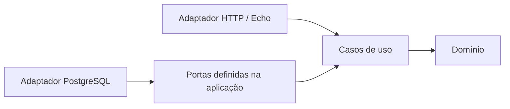

# Desenho do sistema

## Estilo

Monólito modular em Go usando DDD e Clean Architecture. Echo atende HTTP; PostgreSQL é acessado por adaptadores; Redis está proposto para dados efêmeros conforme ADR-011. O domínio não conhece framework, protocolo HTTP nem banco.

## Direção das dependências

O ponto de composição usa Uber Dig: `internal/containers` registra construtores e `cmd/api/main.go` invoca a raiz da aplicação. Transações são coordenadas pela aplicação por uma porta apropriada.

## Bootstrap e ciclo de vida

1. Carregar `.env` somente no desenvolvimento local; no container, usar variáveis de ambiente fornecidas pelo ambiente.
2. `config.Boot()` valida o ambiente e produz uma configuração tipada.
3. `containers.Boot(config)` cria o container Dig e registra os construtores.
4. `Invoke` resolve a aplicação raiz e suas dependências transitivas; só o grafo solicitado é instanciado.
5. O bootstrap executa explicitamente as etapas de inicialização na ordem definida (App, DB, feature flags e, depois, módulos habilitados por flags).
6. Ao encerrar, fechar recursos explicitamente: flush de telemetria e shutdown de servidor/conexões.

Dig não fornece hooks de ciclo de vida. A aplicação controla `Boot`/`Shutdown`; não assumir que construtores resolvidos pelo Dig inicializam ou encerram recursos automaticamente. Módulos opcionais devem ser registrados ou invocados somente após a configuração de feature flags estar disponível.

## Limites entre módulos

- Um módulo não importa entidades internas de outro módulo.
- Integrações entre contextos usam IDs, DTOs pequenos ou portas de aplicação.
- Persistência e formato HTTP pertencem aos adaptadores.
- Não antecipar microsserviços; a separação atual existe para proteger limites do domínio.

## Persistência e atomicidade

Os fluxos de aprovação de orçamento e movimento de estoque precisam compartilhar uma transação PostgreSQL. A aplicação coordena o caso de uso; o domínio define as regras; o adaptador implementa begin/commit/rollback.

## Observabilidade

Logs estruturados devem registrar operação, resultado e correlation/request ID, sem CPF/CNPJ, tokens, credenciais ou corpo HTTP. Stack traces são internos, com acesso restrito, e não são retornados na API.
