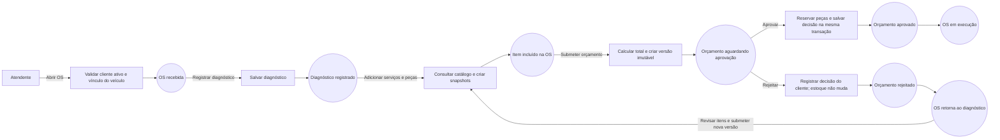
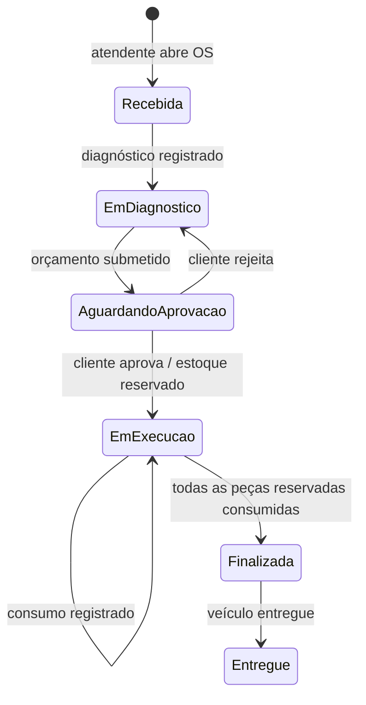
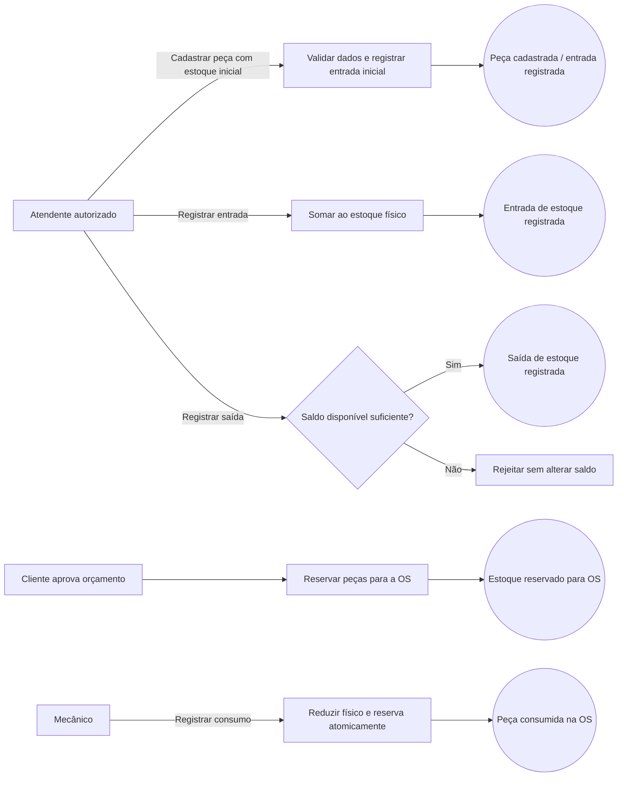

# Event Storming — Oficina

Este documento organiza os fluxos do MVP a partir do comportamento implementado nos módulos `workorder`, `servicecatalog`, `customer` e `vehicle`. Os nomes de eventos abaixo representam fatos do domínio e registros do histórico/movimentações. **Eles não indicam publicação em um barramento**: a aplicação persiste esses fatos no PostgreSQL dentro dos casos de uso e transações existentes.

O diagrama visual editável com as três jornadas está em [event-storming.drawio](event-storming.drawio). Abra o arquivo no [draw.io](https://app.diagrams.net/) para visualizar ou editar. Este Markdown complementa o desenho com a descrição dos comandos, regras, agregados e limites observados no código.

## Legenda

- **Ator**: pessoa ou sistema que inicia uma ação.
- **Comando**: intenção de alterar ou consultar o sistema.
- **Evento**: fato que ocorreu e pode ser registrado.
- **Política**: regra que permite, impede ou coordena uma ação.
- **Agregado**: fronteira de consistência responsável por proteger invariantes.

Os nomes de eventos em português são a linguagem do domínio. Entre parênteses, quando útil, aparece o nome técnico ou a nota gravada no histórico.

## Fluxo 1 — Criação e aprovação da Ordem de Serviço

### Atores e agregados

- **Atendente**: abre a OS, registra diagnóstico, inclui serviços e peças e submete orçamento.
- **Cliente**: consulta e aprova ou rejeita o orçamento.
- **Agregado `WorkOrder`**: mantém cliente, veículo, status, diagnóstico, itens, versões de orçamento e histórico.
- **Agregado `Part` / estoque**: protege saldo físico, reserva e disponibilidade das peças.
- **Catálogo**: fornece os dados e preços usados como snapshot nos itens da OS.

### Linha do tempo

### Comandos, fatos e políticas

| Comando | Fato registrado | Política / regra |
|---|---|---|
| Abrir OS para cliente e veículo | OS recebida (`work order created`) | Cliente deve estar ativo e veículo deve pertencer ao cliente. A validação ocorre antes da criação. |
| Registrar diagnóstico | Diagnóstico registrado (`diagnosis recorded`) | Permitido quando a OS está recebida ou em diagnóstico; o texto não pode ser vazio. |
| Adicionar serviço ou peça | Item incluído (`item added`) | Permitido apenas em diagnóstico. O item precisa existir e estar ativo no catálogo; seus dados e preço são copiados para um snapshot. |
| Remover item | Item removido (`item removed`) | Permitido apenas em diagnóstico e para item pertencente à OS. |
| Submeter orçamento | Orçamento submetido (`quote submitted`) e OS aguardando aprovação | Exige ao menos um item. O total é calculado em centavos e cada submissão cria nova versão com itens e preços preservados. |
| Aprovar orçamento | Orçamento aprovado; OS em execução | Exige versão vigente pendente. A reserva de todas as peças e a gravação da aprovação/status são atômicas; saldo insuficiente cancela a operação. |
| Rejeitar orçamento | Orçamento rejeitado; OS volta ao diagnóstico | Exige versão vigente pendente. A reserva ainda não foi feita, então a rejeição não altera nem desfaz o estoque; permite revisar itens e enviar nova versão. |

### Decisões e limites observados

- Os itens de serviço e peça compartilham a lista da OS, mas mantêm tipo, quantidade, preço e dados de catálogo no snapshot.
- A decisão do cliente é associada ao `client_id`; ações administrativas registram o `user_id`.
- A API de administração e a API do cliente são interfaces distintas. No fluxo do cliente, a identidade vem do token; a decisão não deve aceitar identidade arbitrária do corpo da requisição.
- A aprovação reserva somente peças; serviços não geram movimentação de estoque.
- Uma rejeição não apaga a versão do orçamento. A próxima submissão incrementa a versão.

## Fluxo 2 — Acompanhamento da Ordem de Serviço

### Atores e agregados

- **Atendente / mecânico**: registra diagnóstico, consumo, conclusão e entrega.
- **Cliente**: consulta OS dentro do escopo da sua sessão e decide sobre o orçamento pendente.
- **Agregado `WorkOrder`**: fonte do status atual, das versões de orçamento e do histórico.
- **Sessão do cliente**: limita consultas ao cliente autenticado ou a um veículo autorizado.

### Linha do tempo

### Comandos, fatos e políticas

| Comando | Fato registrado | Política / regra |
|---|---|---|
| Listar OS acessíveis | Consulta realizada (sem evento de domínio) | A listagem é filtrada pelo cliente e, quando aplicável, pelo veículo da sessão. |
| Consultar uma OS | Consulta realizada (sem evento de domínio) | A OS não é retornada se não pertencer ao cliente/veículo autorizado. A API responde como não encontrada fora do escopo. |
| Aprovar ou rejeitar orçamento | Decisão registrada e mudança de status | Só a versão atual pendente pode ser decidida; o cliente é identificado pela sessão. |
| Registrar consumo de peça | Peças consumidas (`reserved parts consumed`) | Só em execução; quantidade positiva e limitada ao restante reservado para aquela peça na OS. Estoque e OS são atualizados na mesma transação. |
| Finalizar serviço | OS finalizada (`work completed`) | Só em execução e após consumir todas as peças incluídas e reservadas. |
| Registrar entrega | Veículo entregue (`vehicle delivered`) | Só após a OS estar finalizada. |

### Histórico e acompanhamento

Cada mudança relevante de status da OS gera uma entrada de histórico com estado anterior e novo estado, instante, nota e ator (`user_id` ou `client_id`). A inclusão/remoção de itens e o consumo também registram entradas. Consultas não alteram o estado e não criam eventos.

O ciclo permitido é: `received` → `diagnosis` → `awaiting_approval` → `in_progress` → `completed` → `delivered`, com retorno de `awaiting_approval` para `diagnosis` em caso de rejeição. Transições fora dessas regras são recusadas pelo domínio.

## Fluxo 3 — Gestão de peças e insumos

### Atores e agregados

- **Administrador / atendente autorizado**: cadastra peças e registra entradas ou saídas manuais.
- **Mecânico**: consome peças que foram reservadas para uma OS em execução.
- **Agregado `Part` / estoque**: mantém quantidade física, reservada e disponível.
- **Agregado `WorkOrder`**: determina a necessidade e o consumo por OS.

### Linha do tempo

### Comandos, fatos e políticas

| Comando | Fato registrado | Política / regra |
|---|---|---|
| Cadastrar peça com estoque inicial | Peça cadastrada e, se o saldo inicial for maior que zero, entrada inicial | SKU, código interno, nome, unidade e preços são validados. O saldo inicial positivo gera movimentação de entrada. |
| Registrar entrada | Entrada de estoque (`entry`) | Quantidade deve ser positiva; aumenta o estoque físico e cria movimentação. |
| Registrar saída | Saída de estoque (`exit`) | Quantidade deve ser positiva e não pode exceder o saldo disponível (`stock - reserved_stock`). |
| Aprovar orçamento com peças | Estoque reservado para a OS | Reserva é associada à OS e ocorre na mesma transação da aprovação. Se qualquer peça não tiver saldo, nenhuma reserva nem aprovação é persistida. |
| Registrar consumo na OS | Peça consumida (`reserved parts consumed`) | Exige OS em execução e consumo até a quantidade reservada/restante daquela peça. Atualiza a reserva, o saldo físico, a OS e a movimentação atomicamente. |
| Excluir peça | Peça desativada/excluída logicamente | Não é permitido excluir quando há saldo físico ou reservado. |
| Consultar movimentações e saldo | Consulta realizada (sem evento de domínio) | O saldo apresenta quantidade física, reservada e disponível; movimentações são listáveis por peça. |

### Invariantes de estoque

- `stock >= 0`.
- `0 <= reserved_stock <= stock`.
- `available_stock = stock - reserved_stock`.
- Saída manual usa o saldo disponível e não consome reserva de OS.
- Aprovação com reserva e consumo de peça são operações atômicas junto com a OS.
- As movimentações registram entradas, saídas, reservas e consumos; o histórico permite explicar a composição do saldo.

## Mapa de comandos para endpoints

Os endpoints abaixo são a interface HTTP documentada no `README.md` e no `api/openapi.yaml`; o caso de uso e o domínio aplicam as regras acima.

| Intenção | Endpoint |
|---|---|
| Abrir, listar e consultar OS | `POST /api/v1/work-orders`, `GET /api/v1/work-orders`, `GET /api/v1/work-orders/{id}` |
| Registrar diagnóstico | `POST /api/v1/work-orders/{id}/diagnosis` |
| Adicionar/remover item | `POST /api/v1/work-orders/{id}/items`, `DELETE /api/v1/work-orders/{id}/items/{item_id}` |
| Submeter orçamento | `POST /api/v1/work-orders/{id}/quotes` |
| Aprovar/rejeitar orçamento | `POST /api/v1/client/work-orders/{id}/quotes/approve` e `/quotes/reject`; a API administrativa também possui rotas correspondentes |
| Registrar consumo, finalizar e entregar | `POST /api/v1/work-orders/{id}/consumptions`, `/complete`, `/deliver` |
| Movimentar e consultar estoque | `POST /api/v1/parts/{id}/stock-movements`, `GET /api/v1/parts/{id}/stock-movements` |
