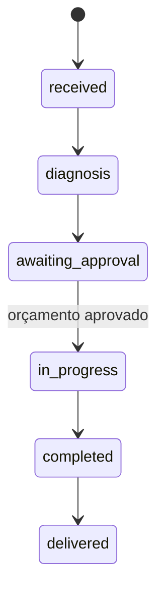

# Ciclo da Ordem de Serviço

## Estados

| Estado interno | Nome apresentado |
|---|---|
| `received` | Recebida |
| `diagnosis` | Em diagnóstico |
| `awaiting_approval` | Aguardando aprovação |
| `in_progress` | Em execução |
| `completed` | Finalizada |
| `delivered` | Entregue |

## Caminho principal

Rejeição do orçamento retorna a OS para diagnóstico. Os itens podem ser revisados e uma nova versão do orçamento pode ser enviada. Falta de estoque impede a aprovação e não altera o estado da OS.

## Regras a preservar

- A OS referencia um cliente e um veículo que pertence a esse cliente.
- Execução não inicia sem aprovação da versão vigente do orçamento.
- Alterações de catálogo não modificam itens/preços já orçados.
- Mudanças de estado são registradas com instante e ator; histórico é append-only pela API normal.
- Aprovação e reserva/baixa de estoque devem ser atômicas.
- Repetição de aprovação não duplica movimentos de estoque nem histórico.

## Fluxo de orçamento

1. A equipe registra diagnóstico e serviços/peças necessários.
2. O caso de uso calcula `subtotal_in_cents` e `total_in_cents`.
3. Uma versão imutável com snapshots de descrição, código, preço e quantidade é disponibilizada para decisão do cliente.
4. Aprovação válida reserva todas as peças na mesma transação que registra a decisão e muda o estado para execução.
5. Rejeição é registrada e retorna a OS para diagnóstico, sem reservar estoque; a próxima submissão cria uma nova versão.
6. Durante a execução, o consumo reduz o saldo físico e a reserva na mesma transação. A OS só pode ser finalizada após consumir todas as peças reservadas.
